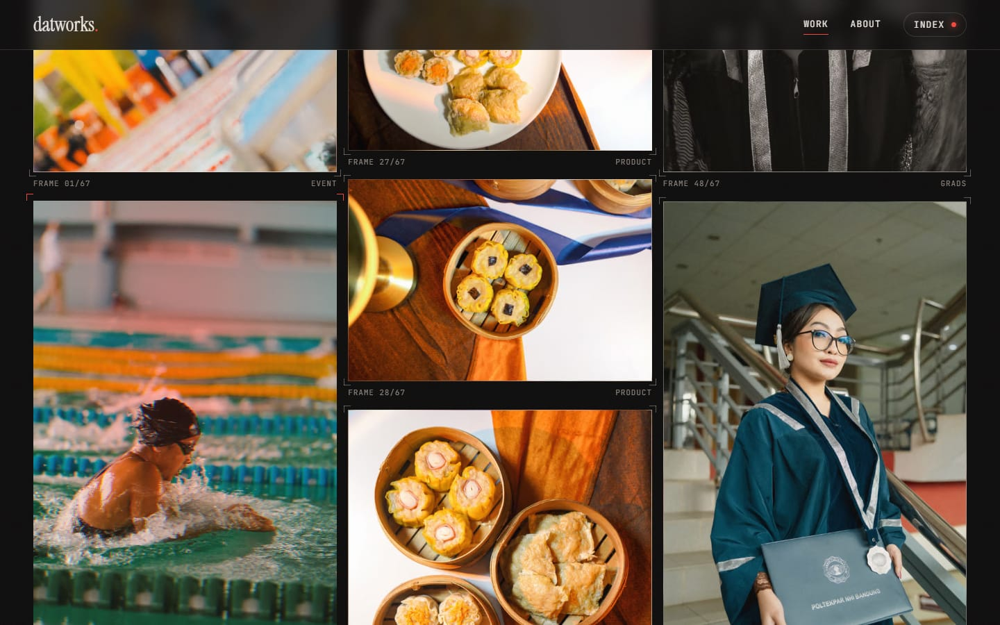
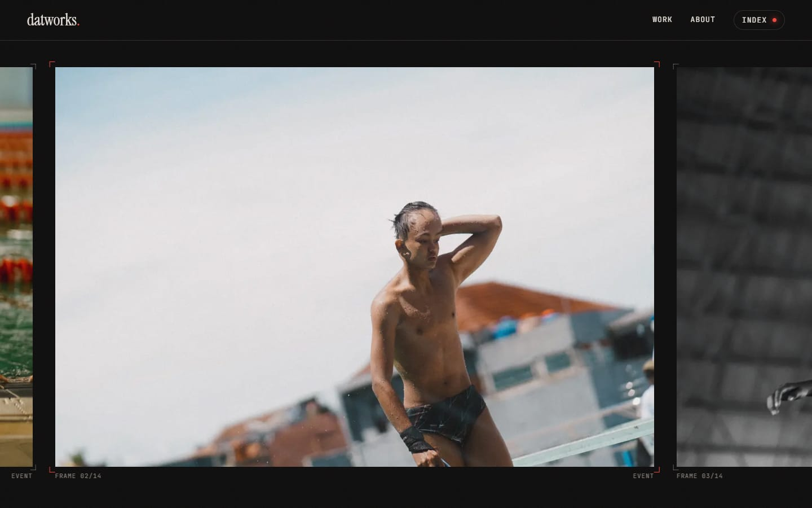

# DARKROOM: a portfolio for datworks

> **Originally built in 2025 for datworks · rebuilt in 2026.**
> A photography portfolio that behaves like a darkroom: photos develop from negative to positive,
> the safelight glows red under your cursor, and the pool series swims sideways as you scroll.

**Live:** _coming soon on Vercel_ · **Stack:** Vite + TypeScript (no UI framework), GSAP, Lenis, OGL (WebGL) · **Tests:** Vitest + Playwright


## The project in one minute

**datworks** ([@datwrk](https://www.instagram.com/datwrk/)) is a photography studio from West Java that shoots a little bit of everything ("The King of All Trades"): pre-weddings and weddings, graduations, sport and corporate events, food and products, studio portraits.

I first built their portfolio site in 2025. The code was never pushed anywhere and was lost, so in 2026 I rebuilt it from scratch, properly this time: specced, ticketed, tested and committed step by step. This repository is that rebuild.

**My role:** everything on the web side. That covers discovery with the client, the concept, design, frontend engineering, the image pipeline, photo curation (114 frames out of ~1,000 originals), accessibility and performance work, testing and deployment. Photography by datworks.

| | |
|---|---|
|  |  |
|  |  |
|  |  |

<p align="center"></p>

## What's inside

- **Five rolls, six series.** The archive is organised like film: rolls (Lover, Grads, Event, Product, Studio) filterable on `/work?roll=…`, plus six series that each get their own layout:
  - **West Java Aquatics:** a pinned, horizontally scrolling strip; photos are redrawn by a WebGL water-ripple shader that reacts to scroll speed and the cursor.
  - **A Love Story in 4 Chapters:** a sticky chapter index that follows the reader, with the page tone drifting from chapter to chapter.
  - **Silat Bumi Padjadjaran:** frames lean and blur with scroll velocity, then snap sharp.
  - **Dara Grad · ACE Gathering:** an editorial rhythm of full-bleed frames, pairs and offset singles.
  - **Still Life:** a contact-sheet catalogue grouped by client.
- **"Developing" preloader.** A fragment shader develops the first showreel frame from an orange film negative to the print under a fading safelight. Phones get the same idea in CSS (`filter: invert()`), and reduced-motion users skip it.
- **Darkroom hover.** On desktop, one shared WebGL canvas draws only the hovered photo: a lens bulge toward the cursor, a hint of colour fringing and the red safelight. Touch devices get a CSS glow.
- **Lightbox** on a native `<dialog>`: arrow keys, swipe, Escape/backdrop to close, focus kept inside and returned to the trigger.
- **Page transitions** (a safelight curtain), smooth scroll and scroll reveals, all off with `prefers-reduced-motion`.

## Technical decisions

| Decision | Why |
|---|---|
| **Vanilla TypeScript + a 100-line History API router**, no UI framework | The site is mostly motion and images. A tiny router with `leave → unmount → swap → enter` hooks gives full control over page transitions and cleanup. |
| **A deep `content` module** (`src/content`) with pure queries and `validate()` | Rolls, series and photos are plain data. Curation rules (10–20 frames per series, 12–16 per roll, ≤ 150 photos, alt text required, no duplicate ids) are enforced at **build time** by a Vite plugin, so invalid content can't ship. |
| **Consent is part of the data** (`ok` / `anonymize` / `exclude`) | Real people are in these photos. `exclude` is filtered once in the catalog so no query can leak it, and client series use aliases (`A & D`). |
| **Own image pipeline** (`npm run photos`) | `sharp` (wasm build, because native binaries are blocked by Windows Application Control on the dev machine) turns a curated manifest into AVIF + WebP at 640/960/1280/1920 px, a 20 px blur preview and dimensions. EXIF/GPS are stripped. It is idempotent, so a new width only encodes what's missing. |
| **One WebGL context per effect**, not per photo | The ripple and hover effects each draw DOM-positioned planes on a single fixed canvas, using the photos' own `` as textures. The DOM stays the source of truth for layout, links and the lightbox. |
| **WebGL only where it pays off** | Shaders run only with a fine pointer, WebGL, ≥ 4 cores/4 GB and motion allowed. OGL ships in a separate chunk that phones never download. |
| **CSS reveals + IntersectionObserver** instead of a ScrollTrigger per element | Removed a ~1 s long task on throttled phones. GSAP ScrollTrigger is kept for the pin, parallax and velocity effects where it shines. |

### Performance and accessibility

Lighthouse, mobile emulation, median of 3 runs on the production build:

| Page | Performance | Accessibility |
|---|---|---|
| Home `/` | 89 | 100 |
| Work `/work` | 92 | 100 |
| Series `/series/dara-grad` | 95 | 100 |

The biggest wins:
- Per-route preload of the LCP image injected into `index.html` at build time (this is a client-rendered app, so the browser would otherwise discover it late).
- A 960 px rendition for phones.
- No smooth-scroll loop, parallax or animated grain on touch devices.
- Splitting OGL out of the main bundle.

Contrast was checked against WCAG AA (the accent red was adjusted to `#f2453a` for 5.36:1).

## Running it

```bash
npm install
npm run dev            # http://localhost:5173
npm run build          # type-check, validate content, build to dist/
npm run preview
```

The processed photos are committed in `public/photos`, so the site runs without the originals. To re-process, put the originals in `originals/` (gitignored) and run `npm run photos`. `scripts/photos.manifest.json` maps photo ids to files.

## Tests

```bash
npm test               # Vitest: content queries, validation, privacy, pipeline output, pure helpers
npm run test:e2e       # Playwright against the production build (uses the installed Microsoft Edge)
```

- **35 unit tests:** catalog queries, every validation rule, the `exclude` privacy guarantee, the pipeline's files and sizes, and pure helpers (editorial rhythm, swipe and velocity mapping).
- **57 end-to-end tests:** routing and back/forward, filters in the URL, the 404, the menu and focus trap, the lightbox (keyboard, swipe, backdrop), the preloader (first visit, skip, no-WebGL fallback), the pinned strip, chapter tracking, motion blur, hover effects with and without WebGL, reduced motion, no layout shift, and no horizontal overflow at 375 px.

## Project structure

```
src/
  content/      data, types, catalog (queries + validate), photo metadata
  pages/        home, work, series (one template, five layouts), about, 404
  ui/           dom helper, photo/picture, lightbox, menu, pure helpers
  router.ts     History API router with lifecycle hooks
  motion.ts     Lenis, page transitions, reveals, pins, velocity effects
  preloader*.ts the developing intro (WebGL + CSS fallback)
  ripple.ts     WebGL water for the Aquatics strip
  hover.ts      WebGL darkroom hover
scripts/        image pipeline, README screenshots
e2e/            Playwright specs
```

## Credits

- **Photography:** © datworks. All rights reserved; the photos are not covered by any code licence and may not be reused.
- **Design and development:** [khanigaraa](https://github.com/khanigaraa).
- Fonts: Instrument Serif, Inter, JetBrains Mono (Google Fonts).

---

## Ringkasan (Bahasa Indonesia)

**DARKROOM** adalah website portofolio fotografi untuk **datworks**, studio foto dari Jawa Barat ("The King of All Trades": pre-wedding, wisuda, event, produk, studio). Website ini awalnya aku buat pada 2025, tetapi kodenya tidak pernah disimpan di GitHub dan hilang. Pada 2026 aku membangunnya ulang dari nol dengan lebih rapi: ada spec, tiket, test, dan commit bertahap.

Sorotan:
- Preloader WebGL yang "mencuci" foto dari negatif ke positif.
- Hover cahaya merah darkroom.
- Galeri renang yang bergerak ke samping dengan efek riak air.
- Kisah cinta dalam 4 bab.
- Lightbox yang ramah keyboard.
- 114 foto hasil kurasi yang diolah ke AVIF/WebP.
- Lighthouse mobile 89–95 dan aksesibilitas 100.

Peranku: konsep, desain, frontend, pipeline gambar, kurasi foto, test, dan deploy. Foto © datworks.
