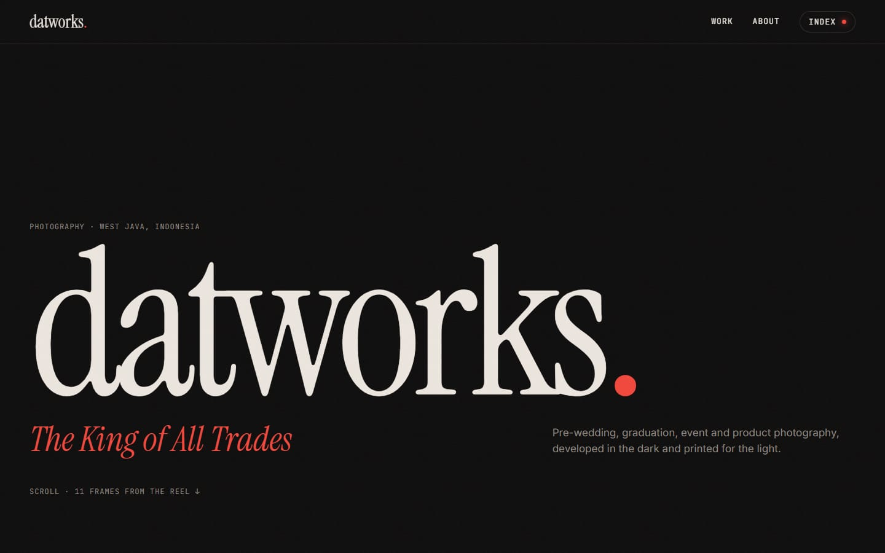
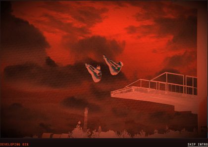
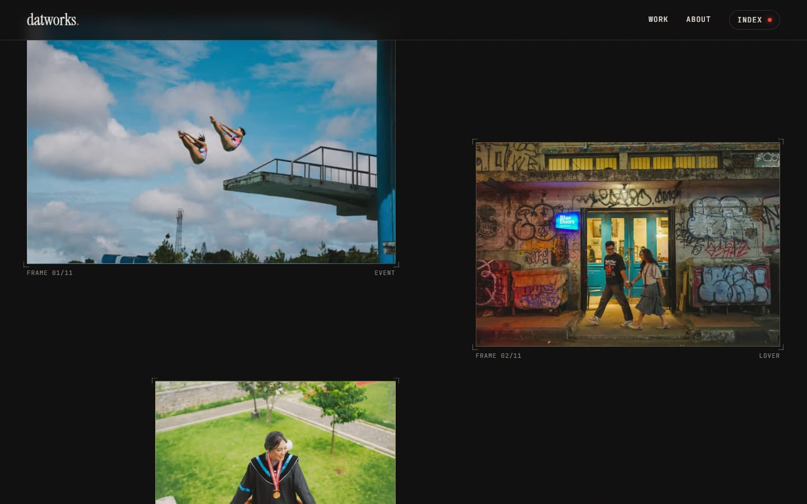
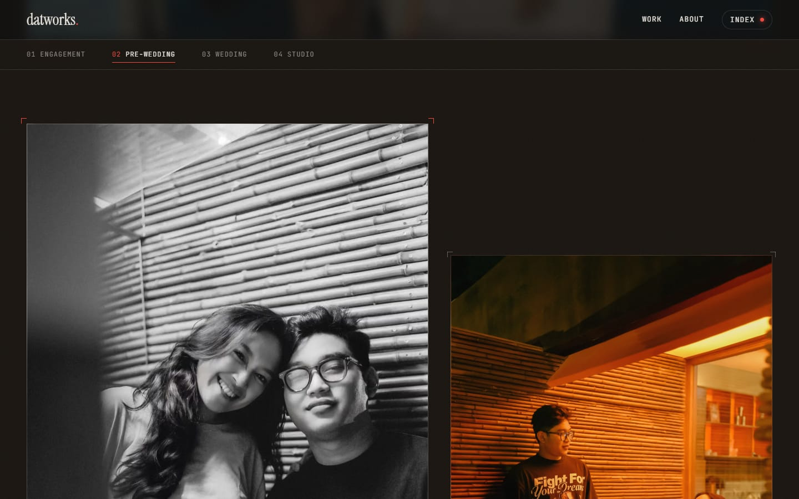
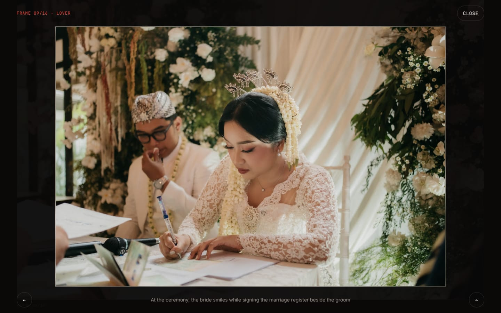
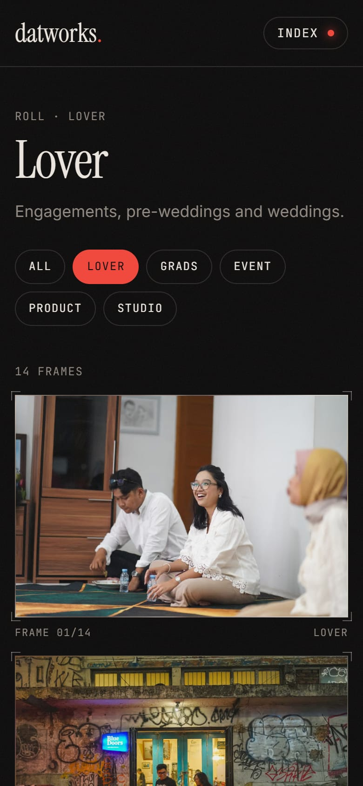
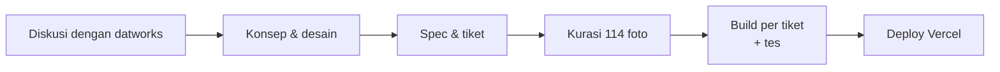

<h1 align="center">DARKROOM</h1>

<p align="center">
  <b>Website portofolio fotografi untuk datworks, yang bekerja seperti kamar gelap.</b><br>
  Foto "dicuci" dari negatif ke positif, lampu merah <i>safelight</i> menyala di bawah kursor, dan seri renang berenang ke samping saat di-scroll.
</p>

<p align="center">
  
  
  
  
</p>

<p align="center">
  <a href="https://datworks-w9bw.vercel.app"><b>Demo live</b></a> ·
  <a href="#fitur">Fitur</a> ·
  <a href="#tangkapan-layar">Tangkapan layar</a> ·
  <a href="#mulai-cepat">Mulai cepat</a> ·
  <a href="#dokumentasi">Dokumentasi</a> ·
  <a href="#english-summary">English</a>
</p>



## Tentang

**datworks** ([@datwrk](https://www.instagram.com/datwrk/)) adalah studio foto dari Jawa Barat yang memotret hampir semua hal ("The King of All Trades"): pre-wedding dan pernikahan, wisuda, olahraga dan acara perusahaan, makanan dan produk, sampai potret studio.

Website portofolio mereka pertama kali aku buat pada 2025. Kodenya tidak pernah disimpan di GitHub dan akhirnya hilang, jadi pada 2026 aku membangunnya ulang dari nol dengan lebih rapi: ada spec, tiket, tes, dan commit bertahap. Repo ini adalah hasil pembangunan ulang tersebut.

- **Status:** demo portofolio. Situs ini berjalan di Vercel, tapi belum dipasang di domain resmi datworks.
- **Peranku:** semua sisi web, mulai dari diskusi dengan klien, konsep, desain, frontend, pipeline gambar, kurasi foto (114 dari ±1.000 foto asli), aksesibilitas dan performa, pengujian, sampai deploy. Fotografi oleh datworks.
- **Yang tidak ada:** tidak ada CMS atau backend. Konten diubah lewat kode di `src/content/`, lalu di-build ulang.

## Fitur

| Bagian | Yang bisa dilihat |
|---|---|
| **Preloader "developing"** | Shader WebGL mencuci frame showreel pertama dari negatif film oranye ke foto jadi. HP mendapat versi CSS, dan pengguna *reduced motion* langsung melewatinya. |
| **Lima roll** | Arsip disusun seperti film: Lover, Grads, Event, Product, Studio. Bisa difilter lewat `/work?roll=…`. |
| **West Java Aquatics** | Strip horizontal yang di-pin. Foto digambar ulang oleh shader riak air yang bereaksi pada kecepatan scroll dan kursor. |
| **A Love Story in 4 Chapters** | Daftar bab yang ikut bergerak, dan warna halaman berganti antar bab. |
| **Silat Bumi Padjadjaran** | Foto miring dan blur mengikuti kecepatan scroll, lalu kembali tajam. |
| **Dara Grad · ACE Gathering** | Ritme editorial: foto penuh, berpasangan, dan satuan yang digeser. |
| **Still Life** | Katalog bergaya contact sheet, dikelompokkan per klien. |
| **Hover darkroom** | Di desktop, satu kanvas WebGL menggambar foto yang sedang di-hover: lensa menggembung ke arah kursor, sedikit pecahan warna, dan cahaya merah. Perangkat sentuh mendapat glow CSS. |
| **Lightbox** | Memakai `<dialog>` native: tombol panah, swipe, Escape atau klik latar untuk menutup, dan fokus terkunci di dalam. |
| **Transisi halaman** | Tirai safelight, smooth scroll, dan reveal saat scroll. Semua mati saat `prefers-reduced-motion` aktif. |

## Tangkapan layar



| | |
|---|---|
|  |  |
|  |  |
|  |  |

Semua gambar di atas dibuat otomatis dengan `npm run screenshots`.

## Alur kerja



## Arsitektur

Aplikasi satu halaman tanpa framework UI. Router History API kecil (±120 baris) menjalankan hook `leave → unmount → swap → enter`, jadi setiap animasi dibersihkan saat pindah halaman. Data foto dan aturan kurasinya dicek **saat build**, dan efek WebGL hanya jalan di perangkat yang mampu. Detail lengkap ada di [docs/ARSITEKTUR.md](docs/ARSITEKTUR.md) dan [docs/KEPUTUSAN-TEKNIS.md](docs/KEPUTUSAN-TEKNIS.md).

| Lapisan | Teknologi |
|---|---|
| Tampilan | TypeScript murni, CSS, router History API buatan sendiri |
| Gerak | GSAP ScrollTrigger, Lenis |
| WebGL | OGL (dipisah ke chunk sendiri, tidak diunduh HP) |
| Gambar | `sharp` → AVIF + WebP (640–1920 px) |
| Tes | Vitest, Playwright |
| Hosting | Vercel (statis) |

## Mulai cepat

Butuh **Node.js 18 atau lebih baru** (diuji dengan Node 26).

```bash
npm install
npm run dev        # http://localhost:5173
npm run build      # cek tipe, validasi konten, build ke dist/
npm run preview
```

Foto hasil olahan sudah ada di `public/photos`, jadi situs bisa langsung jalan tanpa foto asli. Cara mengolah foto baru ada di [docs/PIPELINE-FOTO.md](docs/PIPELINE-FOTO.md).

## Pengujian

```bash
npm test            # 35 unit test (Vitest)
npm run test:e2e    # 61 tes end-to-end (Playwright, memakai Microsoft Edge)
```

Tes end-to-end juga bisa dijalankan ke situs live dengan `BASE_URL`. Daftar lengkap yang dites ada di [docs/PENGUJIAN.md](docs/PENGUJIAN.md).

## Struktur repositori

```text
src/
  content/      data, tipe, katalog (query + validate), metadata foto
  pages/        home, work, series (satu template, lima layout), about, 404
  ui/           helper DOM, foto, lightbox, menu, helper murni
  router.ts     router History API dengan hook lifecycle
  motion.ts     Lenis, transisi halaman, reveal, pin, efek kecepatan
  preloader*.ts intro "developing" (WebGL + fallback CSS)
  ripple.ts     air WebGL untuk strip Aquatics
  hover.ts      hover darkroom WebGL
scripts/        pipeline gambar dan screenshot README
e2e/            tes Playwright
docs/           dokumentasi dan gambar README
```

## Privasi dan hak cipta

Ada orang sungguhan di foto-foto ini, jadi izin tampil disimpan di dalam data (`ok` / `anonymize` / `exclude`). Foto `exclude` disaring sebelum query apa pun berjalan, nama klien diganti alias, dan metadata EXIF/GPS dibuang. Detail di [docs/KONTEN-DAN-PRIVASI.md](docs/KONTEN-DAN-PRIVASI.md).

Semua foto **© datworks** dan dipajang dengan izin mereka.

## Dokumentasi

| Dokumen | Isi |
|---|---|
| [ARSITEKTUR.md](docs/ARSITEKTUR.md) | Router, modul konten, aturan kurasi, efek WebGL, gerak |
| [KEPUTUSAN-TEKNIS.md](docs/KEPUTUSAN-TEKNIS.md) | Kenapa tanpa framework, kenapa satu konteks WebGL, dan keputusan lain |
| [PIPELINE-FOTO.md](docs/PIPELINE-FOTO.md) | Mengolah foto asli jadi AVIF/WebP dengan `npm run photos` |
| [PERFORMA.md](docs/PERFORMA.md) | Skor Lighthouse, perbaikan performa, dan aksesibilitas |
| [PENGUJIAN.md](docs/PENGUJIAN.md) | Isi 35 unit test dan 61 tes end-to-end |
| [KONTEN-DAN-PRIVASI.md](docs/KONTEN-DAN-PRIVASI.md) | Status izin per foto dan hak cipta |

## Kredit dan lisensi

- **Fotografi:** © datworks.
- **Desain dan pengembangan:** [khanigaraa](https://github.com/khanigaraa).
- **Font:** Instrument Serif, Inter, JetBrains Mono (Google Fonts).

**All rights reserved.** Kode di repo ini dipublikasikan hanya untuk dilihat sebagai portofolio, dan tidak boleh dipakai ulang tanpa izin tertulis. Foto tidak termasuk lisensi apa pun. Lihat [LICENSE](LICENSE).

---

## English summary

**DARKROOM** is a photography portfolio for **datworks**, a studio in West Java, Indonesia. I first built it in 2025. That code was lost, so I rebuilt it from scratch in 2026 with a spec, tickets, tests, and step-by-step commits. It is a portfolio demo hosted on Vercel and is not on datworks' own domain.

Highlights:
- a WebGL preloader that "develops" a photo from negative to print;
- a red darkroom hover;
- a horizontally scrolling swimming series with a water-ripple shader;
- a keyboard-friendly lightbox;
- 114 curated photos processed to AVIF/WebP;
- Lighthouse mobile scores of 89–95 for performance and 100 for accessibility.

Stack: vanilla TypeScript, Vite, GSAP, Lenis, OGL. Tests: 35 Vitest and 61 Playwright. I handled everything on the web side; the photography is by datworks.

Code: all rights reserved, for portfolio viewing only. Photos © datworks.
