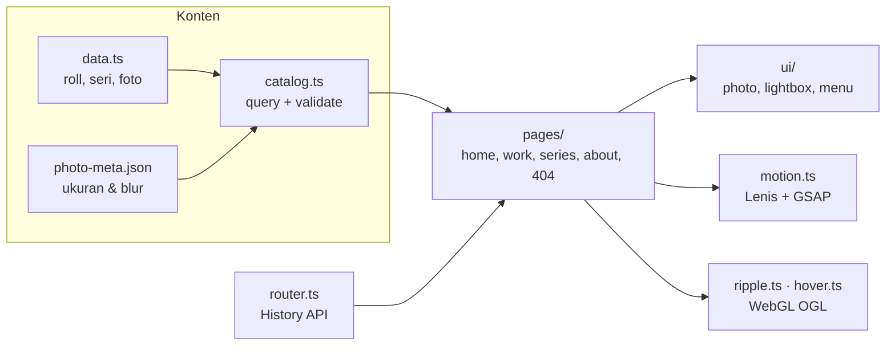

# Arsitektur

DARKROOM adalah aplikasi satu halaman (SPA) tanpa framework UI: TypeScript murni, dibangun dengan Vite, dan di-deploy sebagai file statis di Vercel.

## Router

`src/router.ts` (sekitar 120 baris) memakai History API. Rute yang terdaftar di `src/main.ts`:

| Rute | Halaman |
|---|---|
| `/` | Beranda dan showreel |
| `/work` | Grid arsip, filter lewat `?roll=…` |
| `/series/:slug` | Satu template, lima tata letak seri |
| `/about` | Tentang datworks dan kontak |
| lainnya | 404 |

Setiap pindah halaman menjalankan hook `leave → unmount → swap → enter`, jadi animasi, ScrollTrigger, dan listener dari halaman lama selalu dibersihkan. Perubahan yang cuma query (misalnya ganti filter) melewati `leave` supaya tidak ada transisi halaman.

## Modul konten

Roll, seri, dan foto adalah data biasa di `src/content/data.ts`. `catalog.ts` berisi query murni (tanpa DOM) dan `validate()`.

Aturan kurasi dicek **saat build** oleh plugin Vite, jadi konten yang melanggar tidak bisa ter-deploy. Batasnya ada di `src/content/types.ts`:

| Aturan | Batas |
|---|---|
| Foto showreel | 10–12 |
| Foto galeri per roll | 12–16 |
| Foto per seri | 10–20 |
| Total foto tampil | maks. 150 |
| Alt text | wajib, tidak boleh kosong |
| Id foto | tidak boleh dobel |

## Efek WebGL

- **Satu konteks WebGL per efek**, bukan per foto. Efek riak air (`ripple.ts`) dan hover darkroom (`hover.ts`) masing-masing menggambar bidang yang posisinya mengikuti DOM di satu kanvas tetap, dengan `` foto sebagai tekstur. DOM tetap jadi sumber kebenaran untuk tata letak, link, dan lightbox.
- **Hanya jalan kalau perangkatnya mampu** (`src/capability.ts`): pointer halus (mouse), WebGL tersedia, minimal 4 core dan 4 GB RAM, dan pengguna tidak memilih *reduced motion*.
- **OGL dipisah ke chunk sendiri**, jadi HP tidak pernah mengunduhnya. Perangkat sentuh mendapat versi CSS (glow, `filter: invert()`).

## Gerak dan animasi

`src/motion.ts` mengatur Lenis (smooth scroll), transisi halaman, reveal, pin, dan efek kecepatan scroll. Reveal biasa memakai CSS + IntersectionObserver. GSAP ScrollTrigger hanya dipakai untuk pin, parallax, dan efek kecepatan. Semua efek gerak mati saat `prefers-reduced-motion` aktif.
