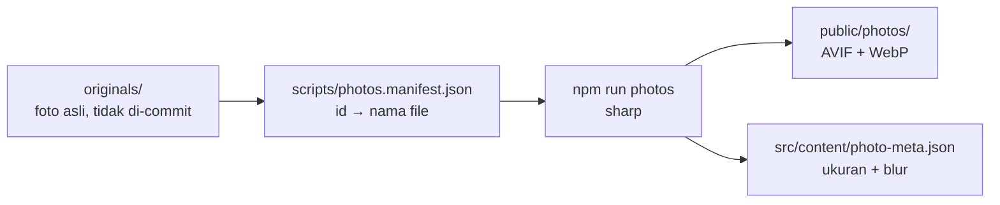

# Pipeline foto

Foto hasil olahan sudah ada di `public/photos`, jadi situs bisa jalan tanpa foto asli. Pipeline ini hanya perlu dijalankan kalau ada foto baru atau ukuran baru.



## Cara menjalankan

1. Taruh foto asli di folder `originals/` (folder ini ada di `.gitignore` dan tidak pernah di-commit).
2. Pastikan id foto terdaftar di `scripts/photos.manifest.json`.
3. Jalankan:

```bash
npm run photos
```

## Yang dihasilkan

| Hasil | Detail |
|---|---|
| Format | AVIF dan WebP |
| Lebar | 640, 960, 1280, 1920 px (960 px cukup untuk HP dengan DPR ±1,75) |
| Pratinjau blur | WebP selebar 20 px, disimpan sebagai data URI di `photo-meta.json` |
| Metadata | EXIF/GPS dibuang (perilaku bawaan `sharp`) |

Pipeline-nya **idempoten**: kalau ditambah satu ukuran baru, hanya file yang belum ada yang di-encode ulang.

## Kurasi

Dari sekitar 1.000 foto asli, 114 frame dipilih untuk situs. Jumlah ini dijaga oleh aturan kurasi yang dicek saat build (lihat [ARSITEKTUR.md](ARSITEKTUR.md#modul-konten)).
